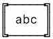
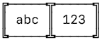
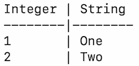

# Duffy

This is a collection of reusable things I don't want to keep duplicating in tons of projects.

## Installation

Add this line to your application's Gemfile:

```ruby
gem 'duffy'
```

And then execute:
```shell
$ bundle
```

## Configuration

Set app-specific options in `config/initializers/duffy.rb`:

```ruby
Duffy.configure do |config|
	config.upcase_custom = %w(NBC CNN DFM)
	config.committers = { "jpd" => "Jacob", "ers|Eric" => "Eric" }
	config.fiscal_month = 7
	config.fiscal_day = 1
end
```

`upcase_custom` adds uppercase exceptions for `smart_titlecase` alongside
`upcase_default`, which defaults to `%w(HR II III IV Q&A USA)`. Assign
`upcase_default` to replace those defaults. `committers` maps regular expression
patterns (strings or regexps) to friendly names for `pretty_committer`.
Both `upcase_custom` and `committers` default to `nil`. The fiscal year starts
on July 1 unless overridden.

Configuration now uses `class_attribute` instead of the deprecated
`ActiveSupport::Configurable`. Existing `Duffy.configure` blocks and direct
`Duffy.configuration.setting` access need no changes, including on older Rails
versions. Class-level setting accessors also remain available.

If an app uses the former ActiveSupport configuration APIs, update it as follows:

| Previous API | Replacement |
|--------------|-------------|
| `Duffy.configuration.config.upcase_custom = values` | `Duffy.configuration.upcase_custom = values` |
| `Duffy.configuration.config[:committers] = mapping` | `Duffy.configuration.committers = mapping` |
| `Duffy::Configuration.config.fiscal_month = 9` | `Duffy::Configuration.fiscal_month = 9` |
| `Duffy::Configuration.configure { \|config\| ... }` | `Duffy.configure { \|config\| ... }` |

`Duffy::Configuration.configure` previously changed class defaults; to retain
that behavior, assign settings directly on `Duffy::Configuration` instead.
The former `.config` options object and arbitrary configuration keys are no
longer supported. When changing array or hash settings, assign a new value
(for example, `config.upcase_default = config.upcase_default + %w(NBC)`)
rather than mutating inherited defaults with `<<` or `merge!`.

## String Patches:

Method            | Example          | Output                             | Notes
------------------|------------------|------------------------------------|------
gender_human      | "F"              | "Female"                           | Deprecated; move this mapping into your application. |
md5               | "duffy"          | "904bc6e21e4799ce276200117215b88b" |
md5sum            | "duffy"          | "904bc6e21e4799ce276200117215b88b" |
nl2br             | "space\nout"     | "space<br/>out"                    | various OS newline permutations
pretty_phone      | "1234567890"     | "(123) 456-7890"                   | US phone number with or without area code
pretty_committer  | "bart"           | "Bartholomew Simpson"              | See config
smart_titlecase   | "this and that"  | "This and That"                    | Has config options. See lib/duffy.rb
space2nbsp        | "space  out"     | "space&nbsp;&nbsp;out"             | Double space holdouts rejoice.
to_alpha          | "abc123"         | "abc"                              |
to_alpha_numeric  | "abc#$%123"      | "abc123                            |
to_box            | "abc".to_box     |             |
to_numeric        | "abc123"         | "123"                              |
to_ssn            | "123456789"      | "123-45-6789"                      |


## Array Patches:
Method            | Example                   | Output
------------------|---------------------------|-------
to_box            | ['abc', 123].to_box       | 
to_markdown       | [[1,2],[3,4]].to_markdown | 

## Date Patches:
* See config to set your organization's fiscal year start.

Method                   | Example                             | Output
-------------------------|-------------------------------------|-------
beginning_of_fiscal_year | Date.today.beginning_of_fiscal_year | 2017-07-01
end_of_fiscal_year       | Date.today.end_of_fiscal_year       | 2018-06-30
fiscal_year              | Date.today.fiscal_year              | 2018


## NilClass Patches:

Method            | Example         | Output
------------------|-----------------|-------
to_date           | nil             | self (Exists so you can call .to_date on Date, String or nil


## Active Record Aliases:

Alias             | Standard
------------------|---------
accepts           | accepts_nested_attributes_for
habtm             | has_and_belongs_to_many


## Git Access:

Method              |   Result
--------------------|---------
Duffy::Git.branch   | Current git branch.
Duffy::Git.count    | Count of git commits in current branch
Duffy::Git.email    | Local repo's git user.email or global if none.
Duffy::Git.log      | Produce tab separated listing of current git log.


## CPU Detection:
* Linux and Mac only for now, numeric methods return 1 on unsupported hosts.
* `virtual?` detects if the system is hypervisor guest. Will return false if unable to determine.
* Example results for my dual core i5 with hyperthreading.

Method    |   Result
----------|---------
Duffy::System.cpus       | 1
Duffy::System.cores      | 2
Duffy::System.threads    | 4
Duffy::System.sane_load  | 3
Duffy::System.cpu_percent| 16
Duffy::System.virtual?   | true

## Memory Statistics:
* All values returned in Megabytes.
* Available + Used always exactly adds up to Total.

Method    |   Result
----------|---------
Duffy::System.mem_total       | 4096
Duffy::System.mem_available   | 3072
Duffy::System.mem_used        | 1024
Duffy::System.mem_percent     | 25


## View Helpers:
* Rails

Method      | Example                             | Result
------------|-------------------------------------|-------
beast_mode  | beast_mode tags               | renders tag partial in parallel. Only available if you have the Parallel gem in your Gemfile.  You must also wrap your partial in a cache block.


## Contributing

1. Fork it ( https://github.com/[my-github-username]/duffy/fork )
2. Create your feature branch (`git checkout -b my-new-feature`)
3. Commit your changes (`git commit -am 'Add some feature'`)
4. Push to the branch (`git push origin my-new-feature`)
5. Create a new Pull Request
